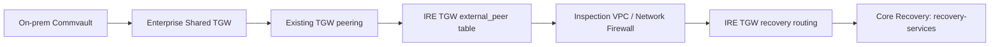

# IRE Shared Transit Gateway — Live Demo Presenter Runbook

**Demo theme:** From broad connectivity testing to controlled Core Recovery access  
**Audience:** Cybersecurity, network engineering, cloud architecture, recovery/Commvault, and project stakeholders  
**Suggested duration:** 15–20 minutes (plus Q&A)  
**Presenter approach:** Use the architecture diagram as your anchor. Show one change and one result at a time. Speak conversationally; don't read Terraform line by line.

> **Demo status:** The original broad configuration was used for connectivity testing. The restricted configuration has been reviewed in Terraform plans; do not describe it as deployed or validated until the Platform and Inspection applies and positive/negative tests actually succeed.

## 0. Prepare before the meeting

Have these ready in separate tabs:

1. Your architecture diagram (show **IRE TGW**, **external Shared TGW**, **peering attachment**, **Inspection VPC / AWS Network Firewall**, and all three recovery VPCs).
2. AAP **Platform Plan** and **Inspection Plan/Apply** job templates, plus the approved execution path. Know which SCM revision and tfvars each job actually consumes.
3. AWS console: IRE TGW route tables; VPC subnet route tables for `admin-tools`, `recovery-services`, `directory-services`, and selected Protected Data subnets; Network Firewall policy and logs; instance Security Groups.
4. A known **enterprise-side test host** that can reach IRE over the Shared TGW/VPN path, plus live private IPs for one test EC2 in each VPC. Use approved, test-only endpoints.
5. A rollback route: prior tfvars commit/branch, pre-change plan output, and the operational approver. Do not improvise rollback through console edits if Terraform owns the objects.

**Critical test condition:** Run the external-connectivity pings **from the enterprise/on-premises source over the Shared TGW path**, targeting the three EC2 private IPs. Pinging between IRE instances tests **internal IRE connectivity**, not whether the *external peering* has been restricted.

**Ping prerequisites:** ICMP Echo Request must be permitted by the instance's SG, operating-system firewall, AWS Network Firewall policy and enterprise-side controls. Some Windows images block ICMP by default. If these prerequisites are not in place, use an approved TCP connection test instead. A failed ping alone does not prove correct isolation.

---

## 1. Opening — 60 seconds

**Say:**

“Today I want to show how we connected our isolated recovery environment back to the enterprise network, and more importantly, how we've reduced the connectivity scope after the initial testing. I'll first show the architecture, then the broad test configuration, demonstrate reachability, and switch to our hardening changes. Finally, we'll compare what is reachable before and after.”

**Transition:** “Let me start with the network path itself.”

## 2. Walk through the architecture diagram — 2–3 minutes

Point to each component in this order.

| Point on diagram | Natural explanation |
|---|---|
| **On-prem / enterprise** | “This is where our existing enterprise connectivity and Commvault components are located.” |
| **Site-to-Site VPN → enterprise Shared TGW** | “The organization already has an enterprise networking hub. We aren't replacing it.” |
| **TGW peering attachment** | “The Shared TGW peers with our dedicated IRE TGW. The peering attachment itself is managed outside our IRE Terraform lifecycle; our stack consumes its existing attachment ID.” |
| **Dedicated IRE TGW** | “This is the internal routing hub for the recovery environment. It's where we keep IRE-specific route tables and segmentation independent from the enterprise hub.” |
| **Inspection VPC / Network Firewall** | “Enterprise-facing traffic is intentionally steered through our Inspection VPC and AWS Network Firewall, rather than directly into workloads.” |
| **Recovery Access VPC** | “Our administration and recovery access plane. It still needs internal IRE connectivity, but we don't need direct enterprise peering routes for this hardening use case.” |
| **Core Recovery VPC** | “The integration point for the approved recovery service. In the restricted design, only the `recovery-services` subnet group gets external connectivity routes.” |
| **Protected Data VPC** | “The isolated workload/data area. It still has selected *internal* routes to other IRE VPCs but no deliberately configured *direct external peering* route in the restricted version.” |

**Say:** “The distinction is important: internal IRE connectivity is one thing; external Shared TGW connectivity is another. We're tightening the second without dismantling the first.”

### Simplified external flow



**Technical caveat if asked:** This is a logical flow. Inspection VPC subnet routes, firewall endpoints, TGW associations and both forward and reverse routes implement the actual forwarding.

## 3. Why a dedicated IRE TGW? — 2 minutes

**Say:**

“We could have considered attaching the IRE VPCs directly to the Shared TGW. But the dedicated IRE TGW gives us a separate routing and operational boundary for cyber recovery. The Shared TGW stays the enterprise connectivity hub; the IRE TGW becomes the hub for recovery-only networks.”

| Advantage | How to explain it clearly |
|---|---|
| **Administrative ownership** | “The IRE team can manage its side of the routing and attachments without taking ownership of the enterprise TGW.” |
| **Smaller blast radius** | “A change to internal IRE routes can be reviewed inside the IRE routing domain rather than routinely modifying the common enterprise hub.” |
| **Explicit external boundary** | “The TGW peering attachment and a dedicated `external_peer` route table make the enterprise entry point visible and controllable.” |
| **Inspection by design** | “Our intended route chain points selected inbound and outbound traffic toward the Inspection VPC.” |
| **Recovery lifecycle independence** | “We can rebuild disposable IRE VPCs and maintain dedicated route policies while preserving the separately managed enterprise peering attachment.” |
| **Configuration-driven expansion** | “If a future recovery workload genuinely needs access, we select its subnet group in tfvars and review the plan instead of redesigning the network.” |

**Fair comparison:** A single Shared TGW *can also* provide route-table segmentation and inspection if designed correctly. A dedicated TGW is not automatically more secure: it adds peering routes, cost, and operational complexity. Our choice is justified by **separate ownership and recovery boundaries**, not by claiming the Shared TGW is inherently unsafe.

**Transition:** “Now I'll show why we originally opened more routes than we ultimately wanted.”

## 4. Before: broad connectivity test — 2 minutes

**Show:** The earlier tfvars / Git diff (or the previously deployed configuration), then the broad-reachability diagram.

**Say:**

“During the integration phase we deliberately enabled external routes to multiple subnet groups. We needed to prove the peering, TGW forwarding, firewall traversal and return path worked before we narrowed access. That was a temporary functional-testing baseline, not our target security posture.”

**Before scope:**

- **Recovery Access:** `admin-tools`.
- **Core Recovery:** `recovery-services`, `directory-services`.
- **Protected Data:** `protected-workloads`, `ingestion`, `database`, `file-services` for inbound selection; earlier outbound map selections may differ, so show the actual old tfvars rather than implying symmetry.
- **Remote destination prefix:** `0.0.0.0/0` in the test routing contract (retained for this phase).
- **SG / firewall:** Temporary all-protocol rules were also introduced to remove application-port uncertainty during initial testing.

**Do not say:** “Every subnet in every VPC was fully open.” The old selections covered specific subnet/route-table groups, not necessarily every subnet or every direction.

## 5. Before: live external reachability tests — 2–3 minutes

**Say:** “From the enterprise-side test machine, I'll now try the private IP of one test instance in each IRE VPC. These are tests across the Shared TGW path—not ping tests between the VPCs.”

| Target | Before: what you're checking | Record actual result |
|---|---|---|
| Recovery Access test EC2, `admin-tools` | External peering reachability in broad baseline | Pass / Fail / Not tested |
| Core Recovery test EC2, `recovery-services` | Permitted recovery path | Pass / Fail / Not tested |
| Protected Data test EC2, selected subnet | External peering reachability in broad baseline | Pass / Fail / Not tested |

**Commands to show only after replacing placeholders with approved private IPs:**

```powershell
ping <recovery-access-private-ip>
ping <core-recovery-private-ip>
ping <protected-data-private-ip>
```

**If a ping unexpectedly fails:** “I'll distinguish whether this is a route, firewall, SG, OS ICMP, or instance issue before using it as evidence.” Don't claim that the topology blocked it simply because ping timed out.

**Transition:** “The broad baseline established our integration test paths. Now we narrow external exposure to the subnet group that actually needs the enterprise connection.”

## 6. Switch to hardening branch — show the three tfvars — 2–3 minutes

**Say:** “For the hardening change, we didn't redesign any VPC, TGW, peering attachment, or firewall. We kept the existing architecture and tightened the configuration.”

### `platform.tfvars` — route selection

**Show the existing block and say:**

“`external_to_ire` selects the destination subnet groups that the enterprise can reach via our inspected TGW routing. `ire_to_external` selects the source route-table groups with routes back toward enterprise networks. Even an enterprise-initiated Commvault connection needs a return path.”

```hcl
remote_cidrs = ["0.0.0.0/0"]

external_to_ire = {
  core_recovery = {
    subnet_groups = ["recovery-services"]
  }
}

ire_to_external = {
  core_recovery = {
    route_table_groups = ["recovery-services"]
  }
}
```

**Important:** `ire_to_external` is a normal route, **not a return-packets-only rule**. It may also carry newly initiated outbound sessions if firewall and SG policies permit them.

### `platform-network-policy.tfvars` — workload SGs

**Say:** “Routes decide whether packets can reach a network. The instance Security Group is the final network permission check at its ENI.”

- Remove temporary all-protocol ingress rules from Recovery Access and Protected Data.
- Replace or temporarily retain Core Recovery ingress **only as required for Commvault-initiated traffic**.
- Keep necessary existing egress until service dependencies are confirmed.
- Your current `core-commvault-from-enterprise` example with `protocol = "-1"` and `peer = "0.0.0.0/0"` is **still a broad temporary exception**, not a hardened Commvault-specific rule. It must ultimately be narrowed to approved source CIDRs and confirmed ports, preferably on a workload-specific SG instead of a shared `core` SG.

**Say:** “We are removing unnecessary scope first. Full least-privilege protocol hardening follows once the Commvault team confirms ports and source IPs.”

### `inspection.tfvars` — AWS Network Firewall

**Say:** “Our firewall policy currently uses VPC-wide logical zones. That's fine for this routing-hardening phase because Platform selects the actual external routes. Firewall rules still control whether new sessions are permitted.”

| SID | Direction | Demo recommendation |
|---|---|---|
| `3100001–3100004` | Internal IRE VPC-to-VPC | Keep unchanged for this demo |
| `3100006–3100007` | Recovery Access ↔ External | Disable in restricted policy |
| `3100008` | Core Recovery → External | Keep temporarily **if** required for initiated recovery/service connections |
| `3100009` | External → Core Recovery | Keep temporarily for enterprise-initiated Commvault testing |
| `3100010–3100011` | Protected Data ↔ External | Disable in restricted policy |

**Explain:** “An `action = "pass", protocol = "ip"` rule is very broad—it is not tied to a Commvault port. We use those temporarily for testing. The desired final policy will permit only verified source/destination networks and application protocols.”

**Safety qualification:** Disabling a broad PASS rule only creates a meaningful deny if the **policy-level default action and other rules** do not permit the traffic. Confirm strict-order rule-group/policy settings, unmatched-traffic action, and effective logging before claiming deny-by-default. For stateful inspection, return traffic behavior depends on connection tracking and rule semantics.

## 7. Pause and review the plans — 2 minutes

**Say:** “Before touching live connectivity, let's check what Terraform actually proposes.”

**Platform plan evidence from your last screenshots:** `0 to add, 0 to change, 15 to destroy` (12 unwanted default route entries + 3 temporary SG ingress entries) **before your new Core ingress rule was added**. A new plan with the replacement rule will have a different summary. Never reuse the old plan result as the current one.

**Check before approving the current Platform plan:**

- Only the intended **unselected** subnet default routes are removed: Recovery Access `admin-tools`, Core Recovery `directory-services`, and selected Protected Data groups.
- Core Recovery `recovery-services` external routes remain in both AZ route tables.
- The resulting `inspection_contract.external_peering.external_to_ire_cidrs` contains the approved `recovery-services` subnet CIDRs, and `ire_to_external_vpc_keys` contains `core_recovery`.
- Required Commvault Core SG ingress still exists; expected SG egress remains.
- No VPC, TGW, peering attachment, firewall, subnet, or unrelated resources are replaced/destroyed.

**Inspection plan:** Check that peering-dependent TGW routes, firewall rule updates, and logging changes match the updated Platform contract. In particular, verify removed external paths and no unexpected changes to internal IRE routes.

**Live execution gate:** Only run AAP APPLY jobs after change approval, correct SCM revision, required connectivity inventory, rollback readiness, and review of both dependency-aware plans. For a restriction/removal, the exact stack order should be coordinated to avoid transient uninspected paths; **do not automatically assume Platform APPLY must precede every Inspection change**. If the demos cannot tolerate a short interruption or exact ordering remains uncertain, present the plans and a separately recorded apply instead of performing live production-like changes.

## 8. After: test the restricted connection — 2–3 minutes

**Say:** “Now I'll run the same enterprise-originated tests from the same host to the same three private IPs. The only path we intend to keep is Core Recovery's `recovery-services` network.”

| Enterprise-side test target | Expected after authorized apply | What proves it |
|---|---|---|
| Recovery Access — `admin-tools` | **No external TGW connectivity** | No matching external route / inspected path; negative test |
| Core Recovery — `recovery-services` | **Allowed on configured test protocols** | Positive test, expected SG+firewall permissions, matching routes |
| Protected Data — selected instance | **No direct external TGW connectivity** | Missing approved external route / tested negative path |

**Caution:** The Core Recovery test may **fail** if you removed broad SG ingress without a matching ICMP rule, if the OS firewall blocks ping, or if Network Firewall no longer permits that flow. In that situation, test the actual approved Commvault TCP service, or set a narrowly scoped, approved **temporary ICMP rule** exclusively for the test endpoint and revert it afterward. Do not re-open all protocols across the shared Core SG just to make a demo ping succeed.

**Extra check:** From Recovery Access, test approved **internal IRE-to-Core** reachability separately. It can remain functional and should **not** be interpreted as an external-access bypass.

**If change has not been applied:** Show the expected state and Terraform plan; do not report the “after” ping outcomes as achieved.

## 9. Close — 60 seconds

**Say:**

“So the outcome isn't that we've disconnected our recovery environment. We've preserved the IRE's internal network, kept the enterprise peering attachment and centralized inspection, and reduced the *external* route exposure to the recovery-services subnets in Core Recovery. We can make these changes through our existing Terraform configuration without rebuilding the environment. The next security step is to replace temporary broad Commvault permissions with confirmed ports, source CIDRs, and workload-specific SG access.”

### Key advantages to leave on screen

- **Controlled external exposure:** external TGW route selection narrowed to a business-required subnet group.
- **Independent recovery network ownership:** dedicated IRE TGW and separate routing domain.
- **Central inspection:** AWS Network Firewall remains in the intended enterprise/IRE traffic path.
- **Defense in depth:** subnet routes + firewall rules + instance SGs are complementary controls.
- **Reproducibility:** Terraform plans show exact route and policy differences for change approval.
- **No peering recreation:** attachment ownership remains with the external network team.
- **Preserved IRE internals:** Recovery Access and Protected Data internal connections are not the same as external peering permissions.

---

## 10. Likely questions — concise, natural answers

**Q: Why is there an `ire_to_external` route if Commvault initiates the connection?**  
A: “The server inside IRE needs a route to reply to the Commvault source. That's why we keep the reverse routing selection. It's not a return-only control; firewall and SG policies decide whether new outbound sessions are allowed.”

**Q: Why not connect all IRE VPCs straight to the enterprise Shared TGW?**  
A: “It's technically possible, but we chose a dedicated IRE TGW to preserve recovery routing ownership, lifecycle independence, and an explicit inspected boundary. We accept the extra peering and routing overhead for that separation.”

**Q: If Protected Data can reach Core Recovery internally, can it reach the enterprise through Core?**  
A: “Not from these explicit external TGW selections alone. But we must test for transit or proxy paths, overlapping defaults, and other forwarded routes before claiming complete isolation.”

**Q: Why keep `0.0.0.0/0`?**  
A: “It's the broad remote routing destination for our current validation phase, not blanket authorization. We're narrowing subnet reachability now; approved enterprise prefixes and application policy are a later hardening gate.”

**Q: Isn't the Core SG still open?**  
A: “At present, our temporary Core Commvault rule is broad for connectivity testing. We won't claim final SG hardening until the Commvault ports and enterprise source prefixes are confirmed and the rule is replaced.”

**Q: Does the firewall have to allow both directions independently?**  
A: “The return packets of an allowed stateful session aren't the same as a new session initiated in the opposite direction. We'll verify policy default action, rule semantics, and flow logs before removing reverse-direction rules.”

**Q: Does a successful ping prove the firewall is working?**  
A: “It proves one ICMP path is reachable. To prove enforcement, we also need a negative test and the relevant route, SG, and firewall evidence. For Commvault itself, the approved application TCP tests matter more than ping.”

**Q: Have we completed the security hardening?**  
A: “We've narrowed the routing design and are validating the controlled rollout. Full protocol- and source-specific rules, operational logging verification, and recovery workflow tests remain.”

---

## Presenter evidence checklist

- [ ] Old configuration and test results clearly labeled **Before**.
- [ ] Restricted branch, commit, and current AAP SCM revision clearly identified.
- [ ] Approved test host sits on **enterprise side** of TGW peering path.
- [ ] Three EC2 private IPs confirmed and responsive to test protocol in the **Before** state.
- [ ] New Platform and Inspection plans reviewed and approved.
- [ ] Required Commvault ingress preserved; no unintended SG egress deletion.
- [ ] Inspection policy default actions and logging verified.
- [ ] Any APPLY operations authorized, monitored, and tied to rollback plan.
- [ ] Same tests repeated after changes, with actual results recorded.
- [ ] Internal IRE connectivity checked separately from external peering.
- [ ] Demo conclusion reflects **observed** results, not just expected results.

### Technical reference links

- [AWS Transit Gateway route tables](https://docs.aws.amazon.com/vpc/latest/tgw/tgw-route-tables.html)
- [AWS TGW peering routing](https://docs.aws.amazon.com/vpc/latest/tgw/tgw-peering-add-route.html)
- [AWS Network Firewall strict rule evaluation](https://docs.aws.amazon.com/network-firewall/latest/developerguide/suricata-rule-evaluation-order.html)
- [AWS Network Firewall policy processing](https://docs.aws.amazon.com/network-firewall/latest/developerguide/firewall-policy-processing.html)
- [AWS EC2 Security Group rules](https://docs.aws.amazon.com/AWSEC2/latest/UserGuide/security-group-rules-reference.html)
