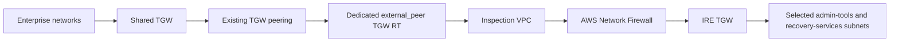

# IRE Shared TGW Peering — Subnet-Level Hardening Runbook

**Scope:** Organization sandbox / existing Shared TGW integration. **Change type:** Configuration-only, subject to plan review. **Target:** Restrict enterprise connectivity to `recovery_access/admin-tools` and `core_recovery/recovery-services`, preserve `remote_cidrs = ["0.0.0.0/0"]`, retain the externally owned peering attachment and VPC-wide Network Firewall zones.

> **Safety gate:** This document gives the exact configuration changes for the target design, **not authorization to apply**. Confirm the desired two subnet groups are approved and that removing externally initiated connections will not interrupt Commvault or another recovery service. Inspect the live plan and firewall default action first. Do not remove all egress or destroy shared infrastructure.

## 1. What changes and what does not

| Layer | File | Required action now |
|---|---|---|
| Platform subnet routing | `terraform/environments/sandbox/config/platform.tfvars` | Narrow `external_to_ire` and `ire_to_external` selections; keep existing peering ID and `0.0.0.0/0` |
| Workload security groups | `terraform/environments/sandbox/config/platform-network-policy.tfvars` | Remove three temporary `*-test-all-from-external` ingress rule objects; **retain** existing `management-egress`, `core-egress`, and `protected-egress` for now |
| Network Firewall | `terraform/environments/sandbox/config/inspection.tfvars` | Keep existing internal IRE rules, disable temporary external PASS rules no longer necessary; keep VPC-wide zones |
| Terraform root/modules | No code change planned | No new stacks, modules, zone abstraction, peering resources, or attachment import |

**What this accomplishes:** Restricts the specific VPC route tables receiving external routes and the external-peer TGW destination subnet prefixes; removes blanket SG ingress. **What it does not accomplish by itself:** A universally enforced subnet-specific firewall policy or port-level allowlisting. Other existing routes, propagated routes, SG attachments, and the Network Firewall default action may change effective reachability.

## 2. `platform.tfvars` — exact peering selections

Find the existing `transit_gateway_peering = { ... }` object **inside `network_config`**. Keep its current `enabled`, `attachment_id`, and any other fields not shown. Replace **only** `remote_cidrs`, `external_to_ire`, and `ire_to_external` with these fields:

```hcl
remote_cidrs = [
  "0.0.0.0/0"
]

external_to_ire = {
  recovery_access = {
    subnet_groups = ["admin-tools"]
  }
  core_recovery = {
    subnet_groups = ["recovery-services"]
  }
}

ire_to_external = {
  recovery_access = {
    route_table_groups = ["admin-tools"]
  }
  core_recovery = {
    route_table_groups = ["recovery-services"]
  }
}
```

**Do not** copy a placeholder attachment ID over your real value. Do not include `directory-services`, `protected-workloads`, `ingestion`, `database`, or `file-services` in this particular two-group baseline. If any of these are essential for Commvault/AD, add them back deliberately **before apply**, not after an outage.

**Expected Platform plan:** Targeted `aws_route` deletions in *unselected* source route tables; updated `inspection_contract.external_peering.external_to_ire_cidrs` and `ire_to_external_vpc_keys`; routes for the two selected groups retained. **Unexpected:** removal of all selected outbound routes, replacement of VPC/TGW/peering, or destruction of an approved route.

## 3. `platform-network-policy.tfvars` — Security Group policy

Inside the existing `security_group_rules = [ ... ]` list, **remove the complete three rule objects** whose `name` values are:

```hcl
"management-test-all-from-external"
"core-test-all-from-external"
"protected-test-all-from-external"
```

Each of these is currently an ingress rule using `protocol = "-1"`, `peer_type = "cidr"`, and `peer = "0.0.0.0/0"`. Delete each object including its braces and comma; **do not remove the whole rule list**.

**Explicitly retain at this stage:**

```hcl
# Existing rule objects: do not remove yet
# name = "management-egress"
# name = "core-egress"
# name = "protected-egress"
```

Also leave the existing inter-VPC SSH/ICMP rules as-is for this narrow peering task. Their separate review should consider SSM-only administration and the actual workload SG attachments.

**SG enforcement caveat:** These three SGs are not intrinsically subnet-specific. Verify which ENIs/workloads use each SG. Removing blanket ingress closes unsolicited traffic only where no other SG rule permits it. For **new enterprise-initiated sessions**, add an explicitly justified replacement ingress rule **before** deleting the relevant broad rule. Never guess Commvault ports or use a fake production CIDR.

**Stateful behavior:** Responses to SG-permitted workload-initiated connections do not require a reverse ingress rule. However, egress still must permit the initial connection.

## 4. `inspection.tfvars` — AWS Network Firewall

Keep internal IRE policy rules **SIDs 3100001–3100004 unchanged**. Keep the existing `recovery_access`, `core_recovery`, `protected_data`, and `external` VPC-wide logical zones; do **not** add subnet-specific firewall-zone variables.

The six temporary external rules were visible in the organization configuration. For a **workload-initiated-only baseline**, keep outbound traffic from the two approved VPCs for the current protocol-discovery phase, and disable the other four rule objects by adding `enabled = false` to each existing object:

| SID | Direction | Change |
|---|---|---|
| `3100006` | Recovery Access → External, `protocol = "ip"` | **Keep enabled temporarily** |
| `3100007` | External → Recovery Access, `protocol = "ip"` | Add `enabled = false` **only if no enterprise-initiated session is required** |
| `3100008` | Core Recovery → External, `protocol = "ip"` | **Keep enabled temporarily** |
| `3100009` | External → Core Recovery, `protocol = "ip"` | Add `enabled = false` **only if no enterprise-initiated session is required** |
| `3100010` | Protected Data → External, `protocol = "ip"` | Add `enabled = false` |
| `3100011` | External → Protected Data, `protocol = "ip"` | Add `enabled = false` |

For example, edit the *existing* SID `3100010` object, keeping all its other fields:

```hcl
{
  action           = "pass"
  protocol         = "ip"
  source_zone      = "protected_data"
  destination_zone = "external"
  description      = "TEMP TEST - Allow Protected Data to external"
  sid              = 3100010
  enabled          = false
},
```

The Inspection variable schema already declares `enabled = optional(bool, true)`, and rule generation includes `if rule.enabled`, so this is an existing supported toggle. Do not create duplicate SIDs or rewrite the list.

**Critical pre-apply gate:** `stateful_rule_options.rule_order = "STRICT_ORDER"` was observed, but the firewall policy's `stateful_default_actions` was not shown. If unmatched traffic is passed, disabling PASS rules will **not** prove that traffic is denied. Confirm the actual applied default action and behavior before calling the firewall hardened. Choosing a new default-drop action without a traffic-impact review can interrupt unrelated recovery flows. Validate return traffic, including TCP handshakes, with the real policy.

**If Commvault requires externally initiated access:** Keep SID `3100007` and/or `3100009` temporarily while you identify validated service/port requirements, or replace them with specific service rules first. Do not describe the system as fully hardened until those broad exceptions are removed.

**Logging:** Your latest `inspection.tfvars` showed `network_firewall_logging_enabled = true`, while an old comment still stated disabled. Verify the effective Terraform plan and actual log delivery; correct the comment separately. A tfvars value alone does not establish that logging is operational.

## 5. Safe validation and deployment gates

1. **Before edits:** Capture the branch, Git status, copies/diffs of the three tfvars, and the currently working connectivity tests. Do not mix customer-specific configuration into the generic/public repository.
2. **Edit configuration:** Make the Platform subnet selection and SG changes above; make the conditional firewall toggles based on approved ingress requirements. Do not modify modules by default.
3. **Validate locally:** Run `terraform fmt -check` on touched files, `terraform validate` for Platform/Inspection with initialized workspaces, and `git diff --check`. `terraform validate` alone cannot test service reachability.
4. **Platform PLAN:** Review **every** delete. Specifically verify the selected admin-tools and recovery-services route-table routes stay, essential SG egress remains, and no VPC/TGW/peering replacement occurs. Reject the prior plan pattern if it deletes `management-egress` or `protected-egress` unintentionally.
5. **Inspection PLAN:** Review changes in firewall policy/rule group and inspected TGW routes. Compare the new Inspection plan against the updated Platform contract. Do not run a blind Inspection apply against a stale contract.
6. **Coordinated APPLY:** Agree an approved change window and apply order with the networking/recovery owners. For this removal-focused change, plan the firewall/SG restrictions and route removal together to avoid an interim unintended allow path. Follow the stack contract/dependency constraints rather than assuming a universal apply order.
7. **Positive + negative testing:** Approved subnets can still reach approved enterprise services (including the known Core Recovery HTTPS test if applicable); unselected subnets fail to reach enterprise; unsolicited external sessions are blocked unless explicitly approved; SSM, DNS, AD, Commvault and recovery workflows still function. Verify AWS Network Firewall and VPC/TGW route/SG evidence.
8. **Closeout:** Save plan summaries, changed-resource inventory, connection-test evidence, and log-delivery proof. Next phase is protocol/port least privilege and eventual narrowing of remote enterprise CIDRs when agreed.

## 6. Read-only inspection commands (organization laptop)

```bash
# Current branch and edits
git branch --show-current
git status --short

# Confirm peering selection and no unexpected scope
grep -n -A 60 'transit_gateway_peering = {' terraform/environments/sandbox/config/platform.tfvars

# Locate SG rule objects that must be removed (and egress objects to retain)
grep -n -E 'test-all-from-external|management-egress|core-egress|protected-egress' terraform/environments/sandbox/config/platform-network-policy.tfvars

# Inspect firewall rule IDs / enabled flags and policy defaults
grep -n -E 'sid|enabled|network_firewall_logging_enabled' terraform/environments/sandbox/config/inspection.tfvars
grep -Rn -C 4 --include='*.tf' 'stateful_default_actions' terraform/stacks/inspection terraform/modules/network-firewall-policy
```

**No `terraform apply`, `terraform destroy`, state import, peering recreation, or force-push is part of these instructions.**

## 7. Architectural boundary



No custom Mermaid colors are specified. **Route selection is not authorization**: preserve inspection and SG controls, and verify there are no alternate or propagated paths that circumvent the intended segmentation.

---

**Status:** Change instructions prepared, not applied. **Explicitly deferred:** Windows/Linux patch repository, Commvault port-specific policy until requirements are verified, and production CIDR reduction.
